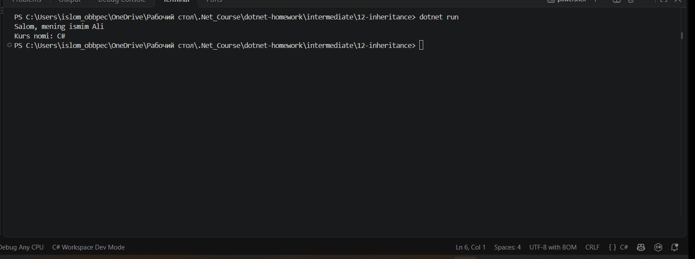
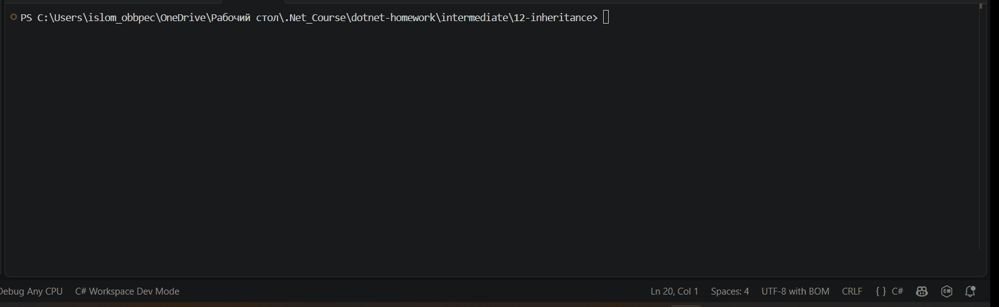
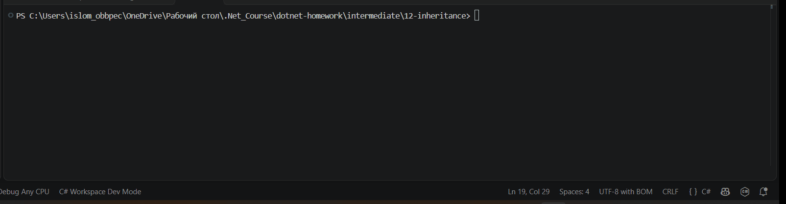
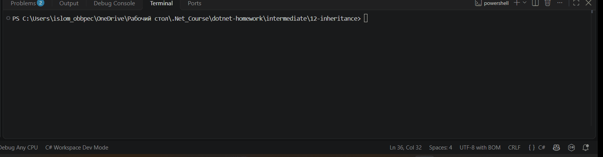
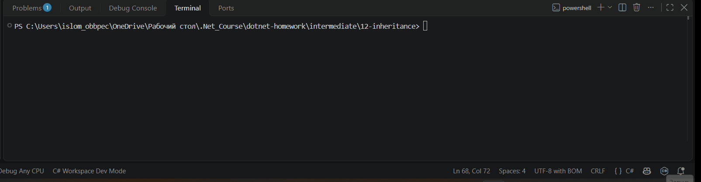
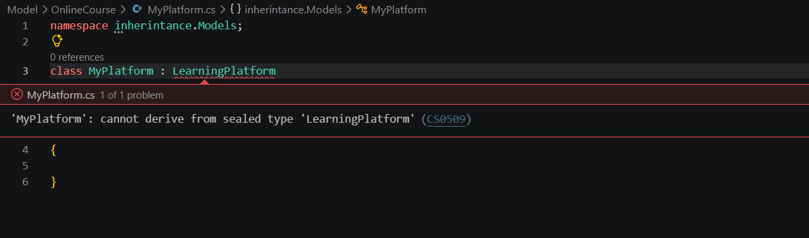
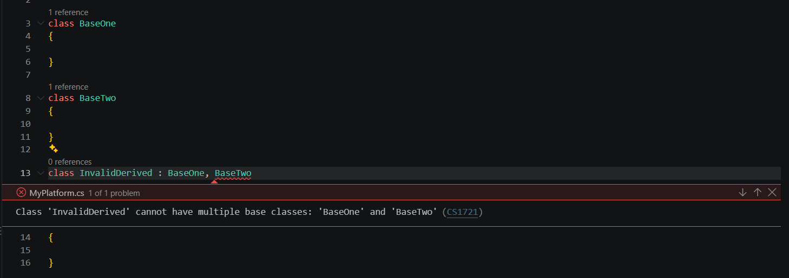

# 12 - Inheritance (Meros olish)

## 📌 Loyiha haqida

Ushbu loyihada C# dasturlash tilida meros olish (Inheritance) mavzusiga oid 5 ta amaliy mashq bajarilgan.

Barcha mashqlar bitta Console Application loyihasida, `Program.cs` faylida amalga oshirilgan.

## 🎯 Ishdan maqsad

- C# tilida meros olish tushunchasini o‘rganish.
- Base class va Derived class bilan ishlash.
- Constructor va `base` kalit so‘zidan foydalanish.
- `private`, `protected`, `public` murojaat darajalarini tushunish.
- `is` va `as` operatorlarini qo‘llash.
- `is-a` va `has-a` munosabatlarini farqlash.
- `sealed` class va bitta classdan meros olish qoidalarini o‘rganish.

## 📚 Bajarilgan mashqlar

### 1. Person va Student — Shaxs va talaba

`Person` nomli asosiy class va undan meros oluvchi `Student` class yaratildi.

**O‘rganilgan tushunchalar:**

- Meros olish (Inheritance).
- Constructor.
- `base` kalit so‘zi.
- Property va Method.

**Kutilgan natija:**

```text
Salom, men Ali.
C#
```

#### Ishga tushirish


----

### 2. Employee, Developer va Designer — Xodim, dasturchi va dizayner

`Employee` asosiy classi va undan meros oluvchi `Developer` hamda `Designer` classlari yaratildi.

**O‘rganilgan tushunchalar:**

- Ierarxik meros olish.
- Base constructor.
- Methodlarni meros qilib olish.
- Har bir classga xos propertylar.

**Kutilgan natija:**

```text
Malika, IT
C#
Jasur, Design
Figma
```
#### Ishga tushirish


----

### 3. Device va Phone — Qurilma va telefon

`Device` asosiy classi va undan meros oluvchi `Phone` classi yaratildi.

**O‘rganilgan tushunchalar:**

- `private` field.
- `protected` property.
- `public` method.
- Murojaat darajalari.

**Kutilgan natija:**

```text
Pixel
Pixel
```
#### Ishga tushirish


Shuningdek, `private` va `protected` a'zolariga tashqi koddan to‘g‘ridan-to‘g‘ri murojaat qilib bo‘lmasligi tekshirildi.


----

### 4. Notification — Xabar turini aniqlash

`Notification` asosiy classi va undan meros oluvchi `EmailNotification` hamda `SmsNotification` classlari yaratildi.

**O‘rganilgan tushunchalar:**

- `is` operatori.
- `as` operatori.
- Pattern Matching.
- `null` qiymatini tekshirish.

**Tekshirish natijalari:**

- Email xabari muvaffaqiyatli aniqlandi.
- SMS xabari muvaffaqiyatli aniqlandi.
- Noto‘g‘ri turga o‘tkazishda `null` qaytarilishi tekshirildi.

#### Ishga tushirish

----


### 5. Online Course — Onlayn kurs

`Course`, `LearningPlatform` va `OnlineCourse` classlari yaratildi.

**O‘rganilgan tushunchalar:**

- Meros olish.
- Kompozitsiya (Composition).
- `is-a` va `has-a` munosabatlari.
- `sealed` class.
- C# tilida bitta classdan meros olish qoidasi.

**Kutilgan natija:**

```text
C#
Online
```


Shuningdek, `sealed` classdan meros olib bo‘lmasligi va C# tilida bir vaqtning o‘zida ikkita classdan meros olish mumkin emasligi tekshirildi.



## 🛠 Foydalanilgan texnologiyalar

- C#
- .NET
- Visual Studio Code
- Console Application

## ▶️ Loyihani ishga tushirish

**1. GitHub repository'ni yuklab oling:**

```bash
git clone https://github.com/is1omzhon/dotnet-homework.git
```

**2. Loyiha papkasiga kiring:**

```bash
cd dotnet-homework/intermediate/12_inheritance
```

**3. Dasturni ishga tushiring:**

```bash
dotnet run
```

## 📁 Loyiha tuzilishi

```text
12_inheritance/
│
├── Program.cs
└── README.md
```

## ✅ Xulosa

Ushbu amaliy ish davomida C# dasturlash tilida meros olish mavzusi o‘rganildi. Asosiy va hosilaviy classlar yaratish, constructorlarda `base` kalit so‘zidan foydalanish, murojaat darajalari bilan ishlash, `is` va `as` operatorlarini qo‘llash hamda kompozitsiya tushunchalari amaliy tarzda bajarildi.

Barcha 5 ta mashq bitta Console Application loyihasida amalga oshirildi va natijalar kutilgan qiymatlar bilan solishtirildi.