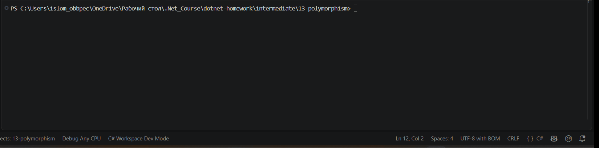
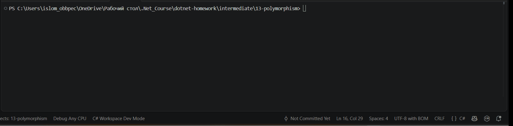
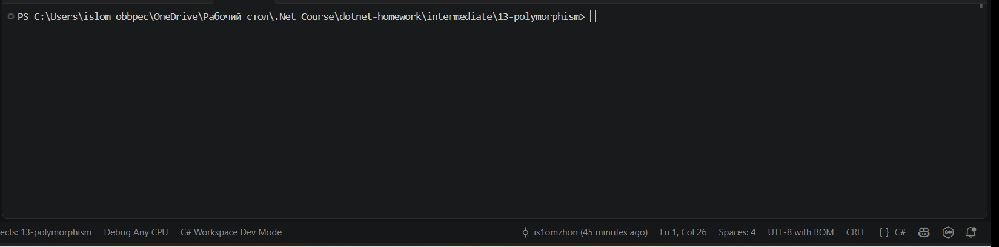

# 12. POLYMORPHISM & METHOD OVERLOADING

## 📌 Umumiy ma'lumot

Ushbu bo‘limda C# dasturlash tilidagi **Polymorphism** va **Method Overloading** tushunchalari o‘rganiladi.

Mashqlar orqali Inheritance, Virtual Methods, Method Overriding, Runtime Polymorphism va Compile-Time Polymorphism bilan ishlash ko‘nikmalari shakllantiriladi.

## 🎯 O‘rganish maqsadlari

- Runtime Polymorphism tushunchasini o‘rganish.
- `virtual` va `override` kalit so‘zlaridan foydalanish.
- Derived classlarda base class methodlarini qayta aniqlash.
- Base class reference orqali derived class objectlari bilan ishlash.
- Method Overloading va Compile-Time Polymorphism farqini tushunish.
- Base class tipidagi massivlar va `foreach` bilan ishlash.

---

## 🟢 OSON

### 1. NOTIFICATION — EMAIL VA SMS YUBORISH

**Classlar:** `Notification`, `EmailNotification`, `SmsNotification`

- `Recipient` va `Message` propertylariga ega `Notification` base class yaratildi.
- Bildirishnoma ma'lumotlarini boshlang‘ich qiymat bilan ta'minlash uchun constructor yaratildi.
- `Send()` methodi `virtual` deb e'lon qilindi.
- `EmailNotification` va `SmsNotification` derived classlari yaratildi.
- `Send()` methodi `override` qilinib, yuborish kanali, oluvchi va xabar chiqarildi.
- Umumiy qiymatlarni parent classga uzatish uchun `base()` ishlatildi.
- Turli notification objectlari `Notification[]` massivida saqlandi.
- `foreach` yordamida har bir objectning tegishli `Send()` methodi chaqirildi.

**O‘rganilgan mavzular:** Inheritance, Virtual Methods, Method Overriding, Runtime Polymorphism.

#### Ishga tushirish

### 2. PAYMENT — TO‘LOV USULLARI

**Classlar:** `Payment`, `CardPayment`, `BankTransferPayment`, `WalletPayment`

- `Pay(decimal amount)` virtual methodiga ega `Payment` base class yaratildi.
- Uch xil to‘lov usuli uchun derived classlar yaratildi.
- Har bir derived classda `Pay()` methodi `override` qilindi.
- To‘lov turi va summasi ekranga chiqarildi.
- Barcha to‘lov objectlari `Payment[]` massivida saqlandi.
- Bitta `foreach` orqali barcha to‘lovlar bir xil summa bilan amalga oshirildi.

**O‘rganilgan mavzular:** Inheritance, Method Overriding, Runtime Polymorphism, Base Type Arrays.

#### Ishga tushirish

### 3. METHOD OVERLOADING — HISOBOTNI CHIQARISH

**Class:** `ReportPrinter`

- Bir xil nomga, ammo turli parametrlarga ega ikkita `Print()` methodi yaratildi.
- `Print(string title)` methodi orqali hisobot sarlavhasi chiqarildi.
- `Print(string title, decimal total)` methodi orqali sarlavha va umumiy summa chiqarildi.
- Ikkala method turli argumentlar bilan chaqirildi.

**O‘rganilgan mavzular:** Method Overloading, Compile-Time Polymorphism.

#### Ishga tushirish

---

## 🟡 O‘RTACHA

### 4. REPORT EXPORTER — PDF VA CSV FORMATLARI

**Classlar:** `ReportExporter`, `PdfReportExporter`, `CsvReportExporter`

- `Export(string data)` virtual methodiga ega `ReportExporter` base class yaratildi.
- PDF va CSV formatlari uchun derived classlar yaratildi.
- Har bir derived classda `Export()` methodi `override` qilindi.
- Hisobot ma'lumotlari va eksport formati ekranga chiqarildi.
- Eksport objectlari `ReportExporter[]` massivida saqlandi.
- `foreach` yordamida bitta hisobot ikki xil formatda eksport qilindi.

**O‘rganilgan mavzular:** Inheritance, Virtual Methods, Method Overriding, Runtime Polymorphism.

---

## 🔴 QIYIN

### 5. DELIVERY — YETKAZIB BERISH NARXINI HISOBLASH

**Classlar:** `Delivery`, `StandardDelivery`, `ExpressDelivery`

- `DistanceKm` propertyga ega `Delivery` base class yaratildi.
- Yetkazib berish masofasini qabul qiluvchi constructor yaratildi.
- Standart hisoblash uchun kilometriga 2 000 so‘mdan hisoblaydigan `CalculateCost()` virtual methodi yaratildi.
- `StandardDelivery` va `ExpressDelivery` derived classlari yaratildi.
- `ExpressDelivery` classida `CalculateCost()` methodi qayta aniqlandi.
- Tezkor yetkazib berish uchun kilometriga 3 500 so‘m va qo‘shimcha 10 000 so‘m xizmat haqi hisobga olindi.
- Barcha yetkazib berish objectlari `Delivery[]` massivida saqlandi.
- Bitta `foreach` yordamida har bir yetkazma narxi va umumiy summa hisoblandi.

**O‘rganilgan mavzular:** Inheritance, Method Overriding, Runtime Polymorphism, Method Return Values.

---

## 📚 Asosiy tushunchalar

| Tushuncha | Vazifasi |
|---|---|
| Inheritance | Parent classdagi xususiyat va methodlardan foydalanish |
| `virtual` | Derived classda methodni qayta aniqlash imkonini beradi |
| `override` | Meros olingan virtual methodning yangi ishlash tartibini belgilaydi |
| `base()` | Parent class constructorini chaqiradi |
| Runtime Polymorphism | Methodning bajarilishi objectning haqiqiy turiga qarab aniqlanadi |
| Method Overloading | Bir xil nomli, turli parametrlarga ega methodlar yaratish |
| Compile-Time Polymorphism | Mos method kompilyatsiya vaqtida tanlanadi |

## ✅ Xulosa

Ushbu bo‘limda C# dasturlash tilining Polymorphism va Method Overloading tushunchalari amaliy mashqlar orqali o‘rganildi.

Inheritance, `virtual`, `override`, `base()` va `foreach` bilan ishlash ko‘nikmalari mustahkamlandi. Shuningdek, Runtime Polymorphism va Compile-Time Polymorphism o‘rtasidagi farqlar amaliy misollar orqali tushunildi.