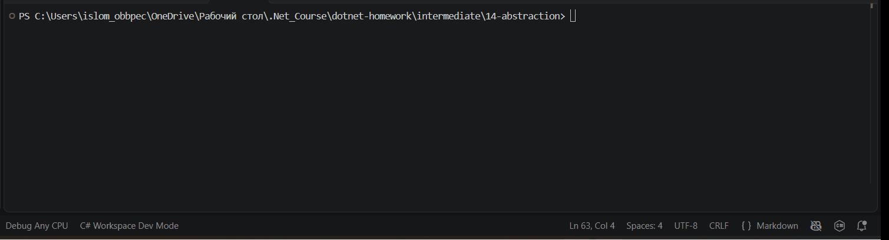
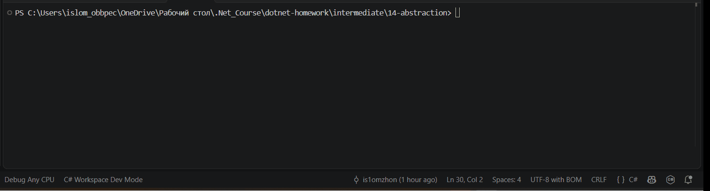
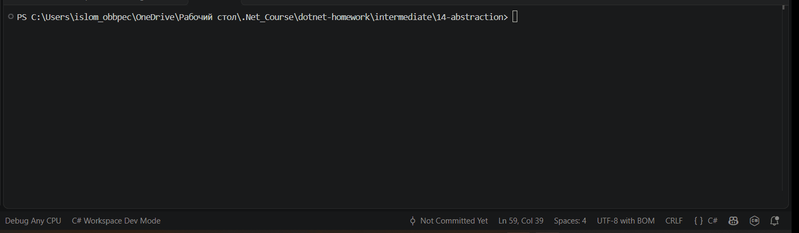
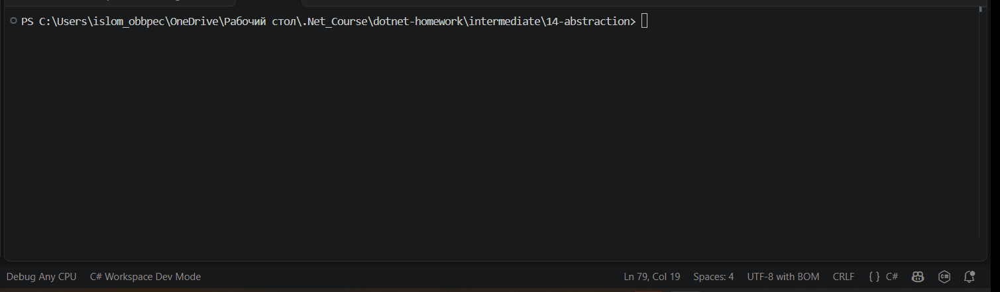

# 14. Abstraction

Abstract class va interface bo'yicha uyga vazifa. Hammasi bitta konsol loyihada.

---

## 1. MediaAsset

- `MediaAsset` abstract class: `Title`, abstract `Play()` va `GetFormat()`, oddiy `ShowTitle()`
- `AudioAsset`, `VideoAsset`, `PodcastAsset` meros olib, ikkala method'ni `override` qiladi
- `MediaAsset[]` massivi va `foreach` orqali chaqirildi
- `new MediaAsset(...)` kompilyatsiyadan o'tmaydi



---

## 2. Appliance

- Abstract `Name` property va `CalculatePowerConsumption(int hours)`
- `WashingMachine` (1 kVt), `AirHeater` (2 kVt), `ElectricKettle` (1.5 kVt)
- Abstract classda oddiy `ShowName()` va `CalculateWeeklyConsumption(int hoursPerDay)`
- `Appliance[]` va bitta `foreach`



---

## 3. IStorage

- `IStorage` interface: `Upload`, `Download`, `GetAvailableSpace`
- `CloudStorage`, `UsbStorage`, `MemoryCardStorage` interface'ni implement qiladi
- Saqlash turi uchun `if` yoki `switch` ishlatilmagan, polimorfizm ishlaydi


---

## 4. IPrinter

- `IPrinter` interface: `Print`, `PrintPreview`, `Clean`
- `LaserPrinter`, `InkjetPrinter`, `ThermalPrinter`
- `IPrinter[]` ichida printer turi tekshirilmaydi, bitta `Print("Dars-jadvali")` ishlaydi



---

## 5. Animal

- `Animal` abstract class: `Name`, constructor, abstract `MakeSound()` va `Move()`, oddiy `DisplayName()`
- `Lion("Sulton")`, `Parrot("Kesha")`, `Elephant("Barno")`
- `Animal[]` va bitta `foreach`



---

## Ishga tushirish

```
dotnet run
```